# Class diagram

> Generated from the TypeScript sources by `pnpm docs:classes` (`tools/docs/class-diagram.mjs`).
> Do not edit it by hand: CI runs `pnpm docs:check` and fails when it is out of date.

## How to read it

- One diagram per layer or API module, so each one stays readable.
- `<<…>>` shows `abstract` and the design pattern named by the class comment (ADR-0035).
- `<|--` is inheritance, `<|..` is an implemented abstraction, `-->` is a constructor or field
  dependency (the arrow points at what the class needs).
- `<<external>>` boxes are classes from another section; their members are in their own diagram.
- Members: `+` public, `#` protected, `-` private (only injected dependencies are listed),
  `*` abstract, `$` static. Private methods are left out.
- The web is MVVM with hooks, so only its model adapters and the store are classes. Its
  ViewModels and Views are described in [frontend-mvvm.md](frontend-mvvm.md).

## Module dependencies

API modules only talk through the public `index.ts` of another module (ADR-0022, ADR-0033).

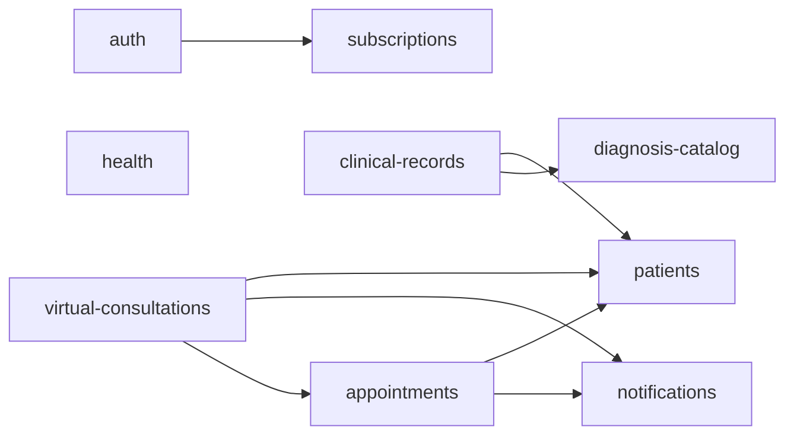

## API core (shared kernel)

26 classes.

```mermaid
classDiagram
  direction LR
  class ApplicationError {
    <<abstract>>
    +kind: ErrorKind
    +code: string
    +details: unknown
  }
  class CalendarMonths {
    +add(date, months)$ Date
  }
  class Clock {
    <<abstract>>
    +now()* Date
  }
  class ConflictError {
    +kind
  }
  class Entity~TProps, TId~ {
    <<abstract · Entity>>
    +id: TId
    #props: TProps
    +equals(other) boolean
  }
  class ForbiddenError {
    +kind
  }
  class HttpView~TViewModel~ {
    <<abstract · Passive View, Template Method>>
    #successStatus: number
    #responder: HttpResponder
    +render(viewModel) void
    +renderError(error) void
    #serialize(viewModel) unknown
  }
  class InputParser {
    +parse(schema, raw)$ T
  }
  class JobLock {
    <<abstract>>
    +acquire(job, leaseMs)* Promise~boolean~
    +release(job)* Promise~void~
  }
  class JsonHttpView~TViewModel~ {
    <<Passive View>>
    #successStatus: number
  }
  class NoContentHttpView {
    <<Passive View>>
    +render() void
  }
  class NotFoundError {
    +kind
  }
  class PasswordHasher {
    <<abstract>>
    +hash(plain)* Promise~string~
    +verify(plain, hash)* Promise~boolean~
  }
  class PaymentDeclinedError {
    +kind
  }
  class Person~TProps~ {
    <<abstract · Entity>>
    +firstName: string
    +lastName: string
    +fullName: string
    +dni: string | null
    +birthDate: Date | null
    +gender: string | null
    +phone: string | null
    +email: string | null
    +address: string | null
    +age(at) number | null
  }
  class Presenter~TInput, TViewModel~ {
    <<abstract · Template Method>>
    #view: View~TViewModel~
    +present(input) Promise~void~
    #execute(input)* Promise~TViewModel~
    #toErrorViewModel(error) ErrorViewModel
  }
  class Repository~TEntity, TId~ {
    <<abstract · Repository>>
    +findById(id)* Promise~TEntity | null~
    +save(entity)* Promise~void~
  }
  class ServiceUnavailableError {
    +kind
  }
  class SubscriptionInactiveError {
  }
  class SystemClock {
    +now() Date
  }
  class TokenService {
    <<abstract>>
    +issue(claims)* Promise~string~
    +verify(token)* Promise~SessionClaims | null~
  }
  class TooManyRequestsError {
    +kind
    +retryAfterSeconds: number
  }
  class TransactionManager {
    <<abstract · Unit of Work>>
    +run(work)* Promise~T~
  }
  class UnauthorizedError {
    +kind
  }
  class ValidationError {
    +kind
  }
  class ValueObject~TProps~ {
    <<abstract · Value Object>>
    #props: Readonly~TProps~
    +equals(other) boolean
  }
  ApplicationError <|-- ConflictError
  ApplicationError <|-- ForbiddenError
  ApplicationError <|-- NotFoundError
  ApplicationError <|-- PaymentDeclinedError
  ApplicationError <|-- ServiceUnavailableError
  ApplicationError <|-- TooManyRequestsError
  ApplicationError <|-- UnauthorizedError
  ApplicationError <|-- ValidationError
  Clock <|-- SystemClock
  Entity <|-- Person
  ForbiddenError <|-- SubscriptionInactiveError
  HttpView <|-- JsonHttpView
  HttpView <|-- NoContentHttpView
```

## API infrastructure

26 classes.

```mermaid
classDiagram
  direction LR
  class ActorReader {
    +from(res)$ AuthenticatedActor
  }
  class AppConfig {
    <<Singleton>>
    +env: Readonly~Env~
    +getInstance()$ AppConfig
    +resetInstance()$ void
    +isProduction: boolean
  }
  class AuthGuard {
    -tokens: TokenService
    -clock: Clock
    +requireSession: RequestHandler
    +requireActiveSubscription: RequestHandler
  }
  class DateTimeFormatter {
    +date(value) string
    +time(value) string
    +dateTime(value) string
  }
  class ErrorHttpView {
    <<Passive View>>
  }
  class ExpressResponderAdapter {
    <<Adapter>>
    -response: Response
    +send(status, body) void
    +noContent() void
    +setCookie(name, value, options) void
    +clearCookie(name) void
  }
  class ExpressServer {
    +app: Express
    -options: ExpressServerOptions
    +listen(port) Promise~Server~
  }
  class HttpErrorHandler {
    -logger: AppLogger
    +notFound: RequestHandler
    +handle: ErrorRequestHandler
  }
  class IntervalJobScheduler {
    -logger: AppLogger
    -lock: JobLock | null
    -initialDelayMs: 
    +start(jobs) void
    +stop() Promise~void~
  }
  class JoseTokenService {
    <<Adapter>>
    +ttlSeconds: number
    +issue(claims) Promise~string~
    +verify(token) Promise~SessionClaims | null~
  }
  class Logger {
    <<Singleton>>
    +REDACTED_PATHS$
    +getInstance()$ PinoLoggerAdapter
    +resetInstance()$ void
  }
  class MailTransport {
    <<abstract>>
    +send(message)* Promise~void~
  }
  class MigrationLog {
    +COLLECTION$
    -database: MongoConnection
    +runOnce(name, work) Promise~boolean~
  }
  class MongoConnection {
    <<Singleton>>
    +getInstance()$ MongoConnection
    +connect(uri, maxPoolSize) Promise~void~
    +disconnect() Promise~void~
    +isConnected: boolean
    +connection: Connection
    +ping() Promise~number~
  }
  class MongoJobLock {
    <<Adapter>>
    +owner
    -database: MongoConnection
    +acquire(job, leaseMs) Promise~boolean~
    +release(job) Promise~void~
  }
  class MongooseRepository~TEntity, TDocument~ {
    <<abstract · Repository, Adapter>>
    #model: Model~TDocument~
    #mapper: DataMapper~TEntity, TDocument~
    -context: TransactionContext
    #session: ClientSession | null
    +findById(id) Promise~TEntity | null~
    +save(entity) Promise~void~
  }
  class MongoRateLimitStore {
    <<Adapter>>
    +COLLECTION$
    -database: MongoConnection
    +hit(id, windowMs, now) Promise~RateLimitWindow~
  }
  class MongoTransactionManager {
    <<Unit of Work, Adapter>>
    -database: MongoConnection
    -context: TransactionContext
    +run(work) Promise~T~
  }
  class OpenApiRegistry {
    <<Singleton, Adapter>>
    +getInstance()$ OpenApiRegistry
    +resetInstance()$ void
    +registerRoute(route) void
    +generateDocument(version) OpenApiDocument
  }
  class PinoLoggerAdapter {
    <<Adapter>>
    -pino: PinoLogger
    +debug(message, context) void
    +info(message, context) void
    +warn(message, context) void
    +error(message, context) void
    +child(bindings) AppLogger
    +native: PinoLogger
  }
  class RateLimiter {
    -enabled: boolean
    -store: RateLimitStore
    -now: Function
    +byIp(req)$ string
    +byEmail(req)$ string | null
    +limit(rules) RequestHandler
  }
  class RateLimitStore {
    <<abstract>>
    +hit(id, windowMs, now)* Promise~RateLimitWindow~
  }
  class ScryptPasswordHasher {
    <<Adapter>>
    +hash(plain) Promise~string~
    +verify(plain, stored) Promise~boolean~
  }
  class SessionCookie {
    -secure: boolean
    -maxAgeSeconds: number
    +write(responder, token) void
    +clear(responder) void
  }
  class SmtpMailTransport {
    <<Adapter>>
    -from: string
    +send(message) Promise~void~
  }
  class TransactionContext {
    +session: ClientSession | null
    +isActive: boolean
    +runWith(session, work) Promise~T~
  }
  class Clock {
    <<external>>
  }
  class HttpView {
    <<external>>
  }
  class JobLock {
    <<external>>
  }
  class PasswordHasher {
    <<external>>
  }
  class Repository {
    <<external>>
  }
  class TokenService {
    <<external>>
  }
  class TransactionManager {
    <<external>>
  }
  AuthGuard --> Clock
  AuthGuard --> TokenService
  HttpView <|-- ErrorHttpView
  IntervalJobScheduler --> JobLock
  JobLock <|-- MongoJobLock
  MailTransport <|-- SmtpMailTransport
  MigrationLog --> MongoConnection
  MongoJobLock --> MongoConnection
  MongoRateLimitStore --> MongoConnection
  MongoTransactionManager --> MongoConnection
  MongoTransactionManager --> TransactionContext
  MongooseRepository --> TransactionContext
  PasswordHasher <|-- ScryptPasswordHasher
  RateLimitStore <|-- MongoRateLimitStore
  RateLimiter --> RateLimitStore
  Repository <|-- MongooseRepository
  TokenService <|-- JoseTokenService
  TransactionManager <|-- MongoTransactionManager
```

## API composition root

1 classes.

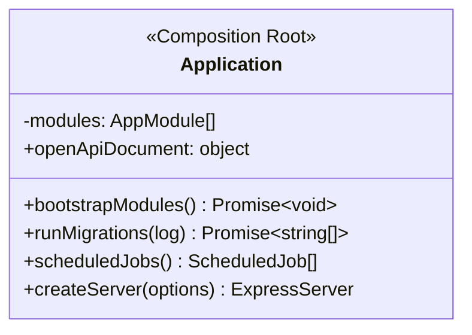

## API module: Appointments (CU-10, CU-11, CU-12, CU-13, CU-14)

20 classes.

```mermaid
classDiagram
  direction LR
  class AgendaLock {
    <<abstract>>
    +acquire(professionalId)* Promise~void~
  }
  class Appointment {
    <<Aggregate Root>>
    +MIN_DURATION$
    +MAX_DURATION$
    +REMINDER_WINDOW_MS$
    +schedule(professionalId, patientId, slot, now)$
    +restore(id, props)$ Appointment
    +endOf(startsAt, durationMinutes)$ Date
    +reschedule(slot, now) void
    +cancel(now) void
    +markReminderSent(now) void
    +needsReminderAt(now, windowMs) boolean
    +overlaps(other) boolean
    +professionalId: string
    +patientId: string
    +startsAt: Date
    +endsAt: Date
    +durationMinutes: number
    +type: AppointmentType
    +modality: AppointmentModality
    +notes: string | null
    +status: AppointmentStatus
    +isScheduled: boolean
    +createdAt: Date
    +updatedAt: Date
    +cancelledAt: Date | null
    +reminderSentAt: Date | null
  }
  class AppointmentDirectory {
    -appointments: AppointmentRepository
    +findOwned(professionalId, appointmentId) Promise~AppointmentSummary | null~
  }
  class AppointmentMapper {
    <<Data Mapper>>
    +toDomain(record) Appointment
    +toPersistence(appointment) AppointmentDocument
  }
  class AppointmentNotifier {
    <<abstract>>
    +notify(event, appointment)* Promise~void~
  }
  class AppointmentRepository {
    <<abstract · Repository>>
    +findOwned(professionalId, id)* Promise~Appointment | null~
    +findStartingBetween(professionalId, from, to)* Promise~Appointment[]~
    +findScheduledOverlapping(professionalId, startsAt, endsAt)* Promise~Appointment[]~
    +findNeedingReminder(from, to, limit)* Promise~Appointment[]~
  }
  class AppointmentRoutes {
    -presenters: AppointmentPresenterFactory
    -guard: AuthGuard
    +build() Router
  }
  class AppointmentService {
    -appointments: AppointmentRepository
    -transactions: TransactionManager
    -patients: PatientNames
    -notifier: AppointmentNotifier
    -clock: Clock
    -lock: AgendaLock
    +list(professionalId, from, to) Promise~AgendaEntry[]~
    +get(professionalId, appointmentId) Promise~AgendaEntry~
    +schedule(professionalId, patientId, slot) Promise~AgendaEntry~
    +reschedule(professionalId, appointmentId, slot) Promise~AgendaEntry~
    +cancel(professionalId, appointmentId) Promise~AgendaEntry~
    +sendDueReminders() Promise~number~
  }
  class AppointmentsModule {
    <<Composition Root, Abstract Factory>>
    +basePath
    +directory: AppointmentDirectory
    -deps: AppointmentsModuleDependencies
    +registerContracts(registry) void
    +createRouter() Router
    +scheduledJobs() ScheduledJob[]
    +listAppointments(view) ListAppointmentsPresenter
    +getAppointment(view) GetAppointmentPresenter
    +scheduleAppointment(view) ScheduleAppointmentPresenter
    +rescheduleAppointment(view) RescheduleAppointmentPresenter
    +cancelAppointment(view) CancelAppointmentPresenter
  }
  class AppointmentViewModel {
    +toDto(appointment,patientName)$ AppointmentDto
    +toSlot(input)$ AppointmentSlot
  }
  class CancelAppointmentPresenter {
    <<Presenter>>
    -agenda: AppointmentService
    #execute(input) Promise~AppointmentDto~
  }
  class GetAppointmentPresenter {
    <<Presenter>>
    -agenda: AppointmentService
    #execute(input) Promise~AppointmentDto~
  }
  class ListAppointmentsPresenter {
    <<Presenter>>
    -agenda: AppointmentService
    #execute(input) Promise~AppointmentDto[]~
  }
  class MongooseAgendaLock {
    <<Adapter>>
    -context: TransactionContext
    +acquire(professionalId) Promise~void~
  }
  class MongooseAppointmentRepository {
    <<Repository, Adapter>>
    +findOwned(professionalId, id) Promise~Appointment | null~
    +findStartingBetween(professionalId, from, to) Promise~Appointment[]~
    +findScheduledOverlapping(professionalId, startsAt, endsAt) Promise~Appointment[]~
    +findNeedingReminder(from, to, limit) Promise~Appointment[]~
  }
  class NotificationAppointmentNotifier {
    <<Adapter>>
    -patients: PatientDirectory
    -notifications: NotificationCenter
    -dates: DateTimeFormatter
    -logger: AppLogger
    +notify(event, appointment) Promise~void~
  }
  class PatientDirectoryNames {
    <<Adapter>>
    -directory: PatientDirectory
    +exists(professionalId, patientId) Promise~boolean~
    +fullNames(professionalId, patientIds) Promise~Map~string, string~~
  }
  class PatientNames {
    <<abstract>>
    +exists(professionalId, patientId)* Promise~boolean~
    +fullNames(professionalId, patientIds)* Promise~Map~string, string~~
  }
  class RescheduleAppointmentPresenter {
    <<Presenter>>
    -agenda: AppointmentService
    #execute(input) Promise~AppointmentDto~
  }
  class ScheduleAppointmentPresenter {
    <<Presenter>>
    -agenda: AppointmentService
    #execute(actor,data) Promise~AppointmentDto~
  }
  class AuthGuard {
    <<external>>
  }
  class Clock {
    <<external>>
  }
  class DateTimeFormatter {
    <<external>>
  }
  class Entity {
    <<external>>
  }
  class MongooseRepository {
    <<external>>
  }
  class NotificationCenter {
    <<external>>
  }
  class PatientDirectory {
    <<external>>
  }
  class Presenter {
    <<external>>
  }
  class Repository {
    <<external>>
  }
  class TransactionContext {
    <<external>>
  }
  class TransactionManager {
    <<external>>
  }
  AgendaLock <|.. MongooseAgendaLock
  AppointmentDirectory --> AppointmentRepository
  AppointmentNotifier <|-- NotificationAppointmentNotifier
  AppointmentRepository <|.. MongooseAppointmentRepository
  AppointmentRoutes --> AuthGuard
  AppointmentService --> AgendaLock
  AppointmentService --> AppointmentNotifier
  AppointmentService --> AppointmentRepository
  AppointmentService --> Clock
  AppointmentService --> PatientNames
  AppointmentService --> TransactionManager
  AppointmentsModule --> AppointmentDirectory
  CancelAppointmentPresenter --> AppointmentService
  Entity <|-- Appointment
  GetAppointmentPresenter --> AppointmentService
  ListAppointmentsPresenter --> AppointmentService
  MongooseAgendaLock --> TransactionContext
  MongooseAppointmentRepository --> TransactionContext
  MongooseRepository <|-- MongooseAppointmentRepository
  NotificationAppointmentNotifier --> DateTimeFormatter
  NotificationAppointmentNotifier --> NotificationCenter
  NotificationAppointmentNotifier --> PatientDirectory
  PatientDirectoryNames --> PatientDirectory
  PatientNames <|-- PatientDirectoryNames
  Presenter <|-- CancelAppointmentPresenter
  Presenter <|-- GetAppointmentPresenter
  Presenter <|-- ListAppointmentsPresenter
  Presenter <|-- RescheduleAppointmentPresenter
  Presenter <|-- ScheduleAppointmentPresenter
  Repository <|-- AppointmentRepository
  RescheduleAppointmentPresenter --> AppointmentService
  ScheduleAppointmentPresenter --> AppointmentService
```

## API module: Auth and account (CU-01, CU-02, CU-03, CU-16, CU-17)

37 classes.

```mermaid
classDiagram
  direction LR
  class AuthModule {
    <<Composition Root, Abstract Factory>>
    +basePath
    -deps: AuthModuleDependencies
    +registerContracts(registry) void
    +createRouter() Router
    +migrations() DataMigration[]
    +registerProfessional(view) RegisterProfessionalPresenter
    +login(view) LoginPresenter
    +getCurrentProfessional(view) GetCurrentProfessionalPresenter
    +requestPasswordRecovery(view) RequestPasswordRecoveryPresenter
    +verifyRecoveryCode(view) VerifyRecoveryCodePresenter
    +resetPassword(view) ResetPasswordPresenter
    +changePassword(view) ChangePasswordPresenter
    +updateProfile(view) UpdateProfilePresenter
    +getLogo(view) GetLogoPresenter
    +uploadLogo(view) UploadLogoPresenter
    +removeLogo(view) RemoveLogoPresenter
  }
  class AuthRoutes {
    -presenters: AuthPresenterFactory
    -guard: AuthGuard
    -cookie: SessionCookie
    -limiter: RateLimiter
    +build() Router
  }
  class AuthService {
    -professionals: ProfessionalRepository
    -access: ProfessionalAccess
    -transactions: TransactionManager
    -hasher: PasswordHasher
    -tokens: TokenService
    -clock: Clock
    +now: Date
    +register(data) Promise~SessionSubject~
    +authenticate(email, password) Promise~SessionSubject~
    +getSession(professionalId, credentialsVersion) Promise~SessionSubject~
    +getProfessional(professionalId) Promise~Professional~
    +changePassword(professionalId, currentPassword, newPassword) Promise~SessionSubject~
    +issueSessionToken(professional,access) Promise~string~
    +assertUnique(email, licenseNumber, ownerId) Promise~void~
    +contactOf(professional)$ object
  }
  class ChangePasswordPresenter {
    <<Presenter>>
    -auth: AuthService
    #execute(input) Promise~SessionResult~
  }
  class CryptoRecoveryCodeGenerator {
    <<Adapter>>
    +generate() string
  }
  class EmailPasswordRecoveryNotifier {
    <<Adapter>>
    -mail: MailTransport
    -dates: DateTimeFormatter
    -recoveryUrl: string
    -logger: AppLogger
    +sendCode(message) Promise~void~
  }
  class GetCurrentProfessionalPresenter {
    <<Presenter>>
    -auth: AuthService
    #execute(actor) Promise~SessionResult~
  }
  class GetLogoPresenter {
    <<Presenter>>
    -profiles: ProfileService
    #execute(actor) Promise~LogoDto~
  }
  class LegacySubscriptionMigration {
    -subscriptions: SubscriptionAccess
    -logger: AppLogger
    +run() Promise~number~
  }
  class LoginPresenter {
    <<Presenter>>
    -auth: AuthService
    #execute(input) Promise~SessionResult~
  }
  class LogoRepository {
    <<abstract · Repository>>
    +find(professionalId)* Promise~ProfessionalLogo | null~
    +save(professionalId, logo, at)* Promise~void~
    +delete(professionalId)* Promise~void~
  }
  class MongooseLogoRepository {
    <<Repository, Adapter>>
    -context: TransactionContext
    +find(professionalId) Promise~ProfessionalLogo | null~
    +save(professionalId, logo, at) Promise~void~
    +delete(professionalId) Promise~void~
  }
  class MongoosePasswordRecoveryRepository {
    <<Repository, Adapter>>
    +findLatestUnused(professionalId) Promise~PasswordRecovery | null~
  }
  class MongooseProfessionalRepository {
    <<Repository, Adapter>>
    +findByEmail(email) Promise~Professional | null~
    +findByLicenseNumber(licenseNumber) Promise~Professional | null~
  }
  class PasswordPolicy {
    +MIN_LENGTH$
    +unmetCriteria(password)$ string[]
    +assertSatisfiedBy(password, field)$ void
  }
  class PasswordRecovery {
    <<Aggregate Root>>
    +TTL_MINUTES$
    +MAX_ATTEMPTS$
    +issue(professionalId, codeHash, now)$ PasswordRecovery
    +restore(id, props)$ PasswordRecovery
    +isUsableAt(now) boolean
    +recordFailedAttempt() void
    +invalidate(now) void
    +professionalId: string
    +codeHash: string
    +expiresAt: Date
    +failedAttempts: number
    +usedAt: Date | null
    +createdAt: Date
  }
  class PasswordRecoveryMapper {
    <<Data Mapper>>
    +toDomain(record) PasswordRecovery
    +toPersistence(recovery) PasswordRecoveryDocument
  }
  class PasswordRecoveryNotifier {
    <<abstract>>
    +sendCode(message)* Promise~void~
  }
  class PasswordRecoveryRepository {
    <<abstract · Repository>>
    +findLatestUnused(professionalId)* Promise~PasswordRecovery | null~
  }
  class PasswordRecoveryService {
    -professionals: ProfessionalRepository
    -recoveries: PasswordRecoveryRepository
    -codes: RecoveryCodeGenerator
    -hasher: PasswordHasher
    -notifier: PasswordRecoveryNotifier
    -transactions: TransactionManager
    -clock: Clock
    +request(email) Promise~void~
    +verify(email, code) Promise~void~
    +reset(email, code, newPassword) Promise~void~
    +invalidCode()$ ValidationError
  }
  class Professional {
    <<Aggregate Root>>
    +register(data, now)$ Professional
    +restore(id, props)$ Professional
    +normalizeEmail(email)$ string
    +normalizeLicense(licenseNumber)$ string
    +updateProfile(profile, now) void
    +changePasswordHash(passwordHash, now) void
    +markLogo(updatedAt, now) void
    +email: string
    +phone: string
    +licenseNumber: string
    +specialty: string
    +offices: string[]
    +passwordHash: string
    +passwordChangedAt: Date | null
    +credentialsVersion: number
    +logoUpdatedAt: Date | null
    +hasLogo: boolean
    +registeredAt: Date
    +updatedAt: Date
  }
  class ProfessionalAccess {
    <<abstract>>
    +startTrial(professionalId, contact)* Promise~AccessState~
    +accessOf(professionalId)* Promise~AccessState | null~
    +updateContact(professionalId, contact)* Promise~void~
  }
  class ProfessionalLogo {
    <<Value Object>>
    +MAX_BYTES$
    +ACCEPTED$
    +fromDataUrl(dataUrl)$ ProfessionalLogo
    +restore(mimeType, base64)$ ProfessionalLogo
    +mimeType: LogoMimeType
    +base64: string
    +toDataUrl() string
  }
  class ProfessionalMapper {
    <<Data Mapper>>
    +toDomain(record) Professional
    +toPersistence(entity) ProfessionalDocument
  }
  class ProfessionalRepository {
    <<abstract · Repository>>
    +findByEmail(email)* Promise~Professional | null~
    +findByLicenseNumber(licenseNumber)* Promise~Professional | null~
  }
  class ProfileService {
    -auth: AuthService
    -professionals: ProfessionalRepository
    -logos: LogoRepository
    -access: ProfessionalAccess
    -transactions: TransactionManager
    -clock: Clock
    +updateProfile(professionalId, profile) Promise~SessionSubject~
    +uploadLogo(professionalId, dataUrl) Promise~void~
    +removeLogo(professionalId) Promise~void~
    +getLogo(professionalId) Promise~ProfessionalLogo | null~
  }
  class RecoveryCodeGenerator {
    <<abstract>>
    +generate()* string
  }
  class RegisterProfessionalPresenter {
    <<Presenter>>
    -auth: AuthService
    #execute(input) Promise~SessionResult~
  }
  class RemoveLogoPresenter {
    <<Presenter>>
    -profiles: ProfileService
    #execute(input) Promise~void~
  }
  class RequestPasswordRecoveryPresenter {
    <<Presenter>>
    -recovery: PasswordRecoveryService
    #execute(input) Promise~RecoveryRequestedDto~
  }
  class ResetPasswordPresenter {
    <<Presenter>>
    -recovery: PasswordRecoveryService
    #execute(input) Promise~void~
  }
  class SessionHttpView {
    <<Passive View>>
    -cookie: SessionCookie
    #successStatus: number
    +render(viewModel) void
  }
  class SessionViewModel {
    +from(professional,access)$ SessionDto
  }
  class SubscriptionAccessAdapter {
    <<Adapter>>
    -subscriptions: SubscriptionAccess
    +startTrial(professionalId, contact) Promise~AccessState~
    +accessOf(professionalId) Promise~AccessState | null~
    +updateContact(professionalId, contact) Promise~void~
  }
  class UpdateProfilePresenter {
    <<Presenter>>
    -profiles: ProfileService
    #execute(actor,data) Promise~SessionDto~
  }
  class UploadLogoPresenter {
    <<Presenter>>
    -profiles: ProfileService
    #execute(input) Promise~void~
  }
  class VerifyRecoveryCodePresenter {
    <<Presenter>>
    -recovery: PasswordRecoveryService
    #execute(input) Promise~void~
  }
  class AuthGuard {
    <<external>>
  }
  class Clock {
    <<external>>
  }
  class DateTimeFormatter {
    <<external>>
  }
  class Entity {
    <<external>>
  }
  class HttpView {
    <<external>>
  }
  class MailTransport {
    <<external>>
  }
  class MongooseRepository {
    <<external>>
  }
  class PasswordHasher {
    <<external>>
  }
  class Person {
    <<external>>
  }
  class Presenter {
    <<external>>
  }
  class RateLimiter {
    <<external>>
  }
  class Repository {
    <<external>>
  }
  class SessionCookie {
    <<external>>
  }
  class SubscriptionAccess {
    <<external>>
  }
  class TokenService {
    <<external>>
  }
  class TransactionContext {
    <<external>>
  }
  class TransactionManager {
    <<external>>
  }
  class ValueObject {
    <<external>>
  }
  AuthRoutes --> AuthGuard
  AuthRoutes --> RateLimiter
  AuthRoutes --> SessionCookie
  AuthService --> Clock
  AuthService --> PasswordHasher
  AuthService --> ProfessionalAccess
  AuthService --> ProfessionalRepository
  AuthService --> TokenService
  AuthService --> TransactionManager
  ChangePasswordPresenter --> AuthService
  EmailPasswordRecoveryNotifier --> DateTimeFormatter
  EmailPasswordRecoveryNotifier --> MailTransport
  Entity <|-- PasswordRecovery
  GetCurrentProfessionalPresenter --> AuthService
  GetLogoPresenter --> ProfileService
  HttpView <|-- SessionHttpView
  LegacySubscriptionMigration --> SubscriptionAccess
  LoginPresenter --> AuthService
  LogoRepository <|-- MongooseLogoRepository
  MongooseLogoRepository --> TransactionContext
  MongoosePasswordRecoveryRepository --> TransactionContext
  MongooseProfessionalRepository --> TransactionContext
  MongooseRepository <|-- MongoosePasswordRecoveryRepository
  MongooseRepository <|-- MongooseProfessionalRepository
  PasswordRecoveryNotifier <|-- EmailPasswordRecoveryNotifier
  PasswordRecoveryRepository <|.. MongoosePasswordRecoveryRepository
  PasswordRecoveryService --> Clock
  PasswordRecoveryService --> PasswordHasher
  PasswordRecoveryService --> PasswordRecoveryNotifier
  PasswordRecoveryService --> PasswordRecoveryRepository
  PasswordRecoveryService --> ProfessionalRepository
  PasswordRecoveryService --> RecoveryCodeGenerator
  PasswordRecoveryService --> TransactionManager
  Person <|-- Professional
  Presenter <|-- ChangePasswordPresenter
  Presenter <|-- GetCurrentProfessionalPresenter
  Presenter <|-- GetLogoPresenter
  Presenter <|-- LoginPresenter
  Presenter <|-- RegisterProfessionalPresenter
  Presenter <|-- RemoveLogoPresenter
  Presenter <|-- RequestPasswordRecoveryPresenter
  Presenter <|-- ResetPasswordPresenter
  Presenter <|-- UpdateProfilePresenter
  Presenter <|-- UploadLogoPresenter
  Presenter <|-- VerifyRecoveryCodePresenter
  ProfessionalAccess <|-- SubscriptionAccessAdapter
  ProfessionalRepository <|.. MongooseProfessionalRepository
  ProfileService --> AuthService
  ProfileService --> Clock
  ProfileService --> LogoRepository
  ProfileService --> ProfessionalAccess
  ProfileService --> ProfessionalRepository
  ProfileService --> TransactionManager
  RecoveryCodeGenerator <|-- CryptoRecoveryCodeGenerator
  RegisterProfessionalPresenter --> AuthService
  RemoveLogoPresenter --> ProfileService
  Repository <|-- PasswordRecoveryRepository
  Repository <|-- ProfessionalRepository
  RequestPasswordRecoveryPresenter --> PasswordRecoveryService
  ResetPasswordPresenter --> PasswordRecoveryService
  SessionHttpView --> SessionCookie
  SubscriptionAccessAdapter --> SubscriptionAccess
  UpdateProfilePresenter --> ProfileService
  UploadLogoPresenter --> ProfileService
  ValueObject <|-- ProfessionalLogo
  VerifyRecoveryCodePresenter --> PasswordRecoveryService
```

## API module: Clinical records (CU-07, CU-08, CU-09)

25 classes.

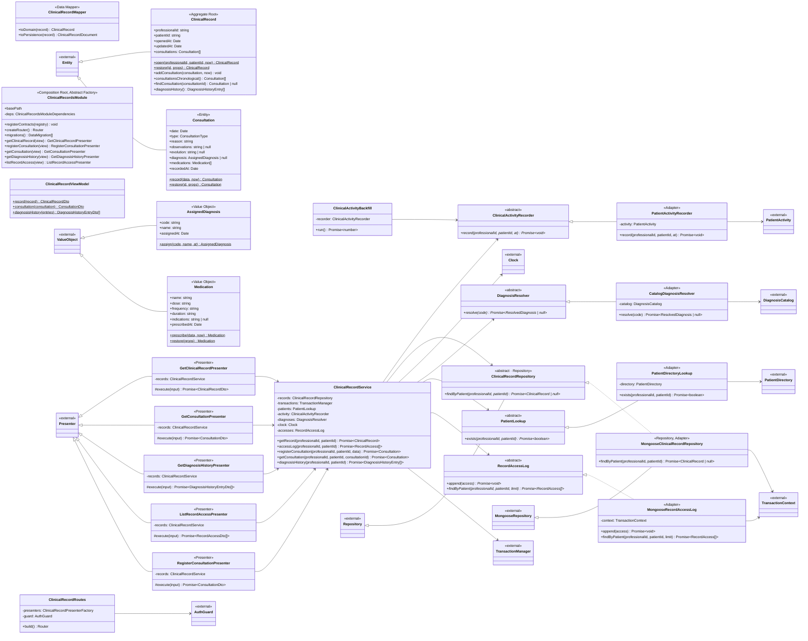

## API module: Diagnosis catalog

9 classes.

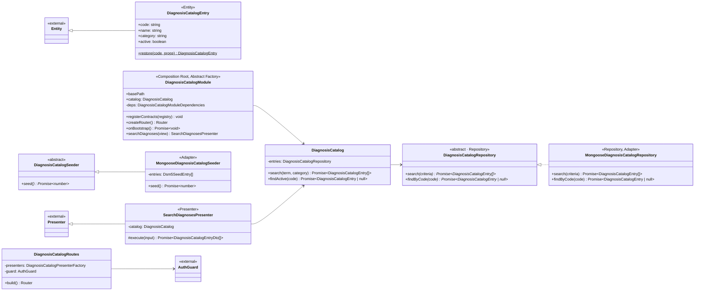

## API module: Health

11 classes.

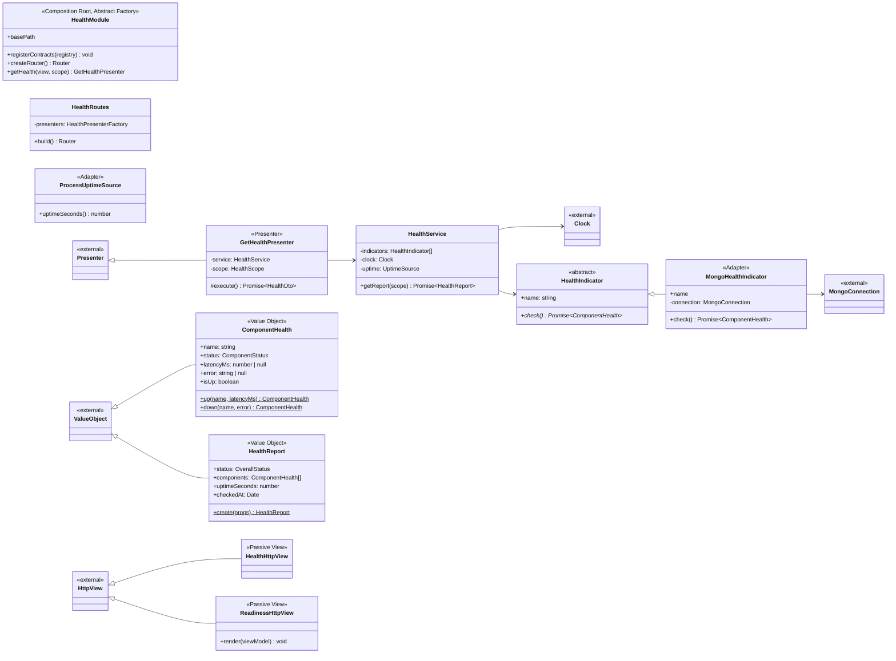

## API module: Notifications

14 classes.

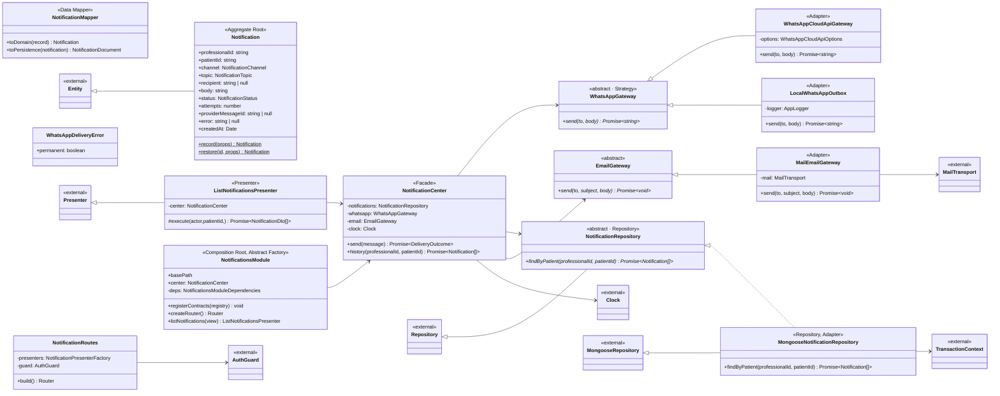

## API module: Patients (CU-04, CU-05, CU-06)

17 classes.

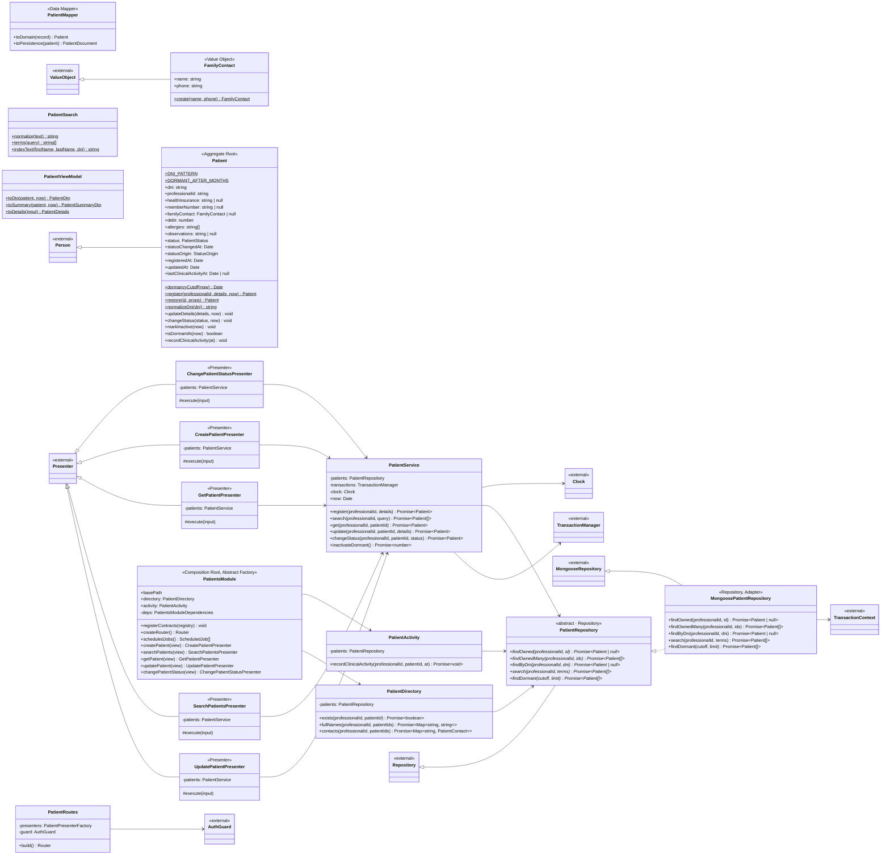

## API module: Subscriptions and payments (CU-18)

29 classes.

```mermaid
classDiagram
  direction LR
  class AddPaymentMethodPresenter {
    <<Presenter>>
    -service: SubscriptionService
    #execute(actor,data) Promise~SubscriptionDetailDto~
  }
  class BillingNotifier {
    <<abstract>>
    +notify(contact, event)* Promise~void~
  }
  class CancelSubscriptionPresenter {
    <<Presenter>>
    -service: SubscriptionService
    #execute(actor) Promise~SubscriptionDetailDto~
  }
  class ChoosePlanPresenter {
    <<Presenter>>
    -service: SubscriptionService
    #execute(actor,data) Promise~SubscriptionDetailDto~
  }
  class EmailBillingNotifier {
    <<Adapter>>
    -mail: MailTransport
    -dates: DateTimeFormatter
    -planUrl: string
    -logger: AppLogger
    +notify(contact, event) Promise~void~
  }
  class GetSubscriptionPresenter {
    <<Presenter>>
    -service: SubscriptionService
    #execute(actor) Promise~SubscriptionDetailDto~
  }
  class ListPaymentsPresenter {
    <<Presenter>>
    -service: SubscriptionService
    #execute(actor) Promise~PaymentDto[]~
  }
  class MongoosePaymentRepository {
    <<Repository, Adapter>>
    +findByProfessional(professionalId, limit) Promise~Payment[]~
    +countByProfessional(professionalId) Promise~number~
    +hasChargeKey(chargeKey) Promise~boolean~
    +hasManualReference(professionalId, reference) Promise~boolean~
  }
  class MongooseSubscriptionRepository {
    <<Repository, Adapter>>
    +findDue(now, limit) Promise~Subscription[]~
  }
  class Payment {
    <<Aggregate Root>>
    +charged(data, now)$ Payment
    +manual(data, now)$ Payment
    +restore(id, props)$ Payment
    +professionalId: string
    +planId: PlanId
    +amount: number
    +currency: string
    +kind: PaymentKind
    +status: PaymentStatus
    +methodLabel: string
    +reference: string | null
    +chargeKey: string | null
    +failureReason: string | null
    +paidAt: Date
    +createdAt: Date
  }
  class PaymentGateway {
    <<abstract · Strategy>>
    +tokenizeCard(card)* Promise~TokenizedCard~
    +charge(request)* Promise~ChargeResult~
  }
  class PaymentMapper {
    <<Data Mapper>>
    +toDomain(record) Payment
    +toPersistence(payment) PaymentDocument
  }
  class PaymentMethod {
    <<Value Object>>
    +register(props, now)$ PaymentMethod
    +restore(props)$ PaymentMethod
    +assertValidExpiry(expMonth, expYear, now)$ void
    +withChanges(changes, now) PaymentMethod
    +id: string
    +brand: CardBrand
    +last4: string
    +expMonth: number
    +expYear: number
    +holderName: string
    +gatewayToken: string
    +addedAt: Date
    +label: string
  }
  class PaymentRepository {
    <<abstract · Repository>>
    +findByProfessional(professionalId, limit)* Promise~Payment[]~
    +countByProfessional(professionalId)* Promise~number~
    +hasChargeKey(chargeKey)* Promise~boolean~
    +hasManualReference(professionalId, reference)* Promise~boolean~
  }
  class Plan {
    <<Value Object>>
    +create(props)$ Plan
    +id: PlanId
    +name: string
    +description: string
    +months: number
    +price: number
    +currency: string
    +periodEndFrom(start) Date
  }
  class PlanCatalog {
    +all() Plan[]
    +get(planId) Plan
  }
  class RegisterManualPaymentPresenter {
    <<Presenter>>
    -service: SubscriptionService
    #execute(actor,data) Promise~PaymentDto~
  }
  class RemovePaymentMethodPresenter {
    <<Presenter>>
    -service: SubscriptionService
    #execute(actor,methodId,confirmed,) Promise~SubscriptionDetailDto~
  }
  class SetAutoDebitPresenter {
    <<Presenter>>
    -service: SubscriptionService
    #execute(actor,data) Promise~SubscriptionDetailDto~
  }
  class SimulatedPaymentGateway {
    <<Adapter>>
    +tokenizeCard(card) Promise~TokenizedCard~
    +charge(request) Promise~ChargeResult~
  }
  class Subscription {
    <<Aggregate Root, State>>
    +startTrial(professionalId, contact, now, trialDays)$ Subscription
    +migrate(professionalId, contact, legacyPlan, endsAt, now)$ Subscription
    +restore(professionalId, props)$ Subscription
    +statusAt(now) SubscriptionStatus
    +hasAccessAt(now) boolean
    +daysLeftAt(now) number
    +isDueAt(now) boolean
    +choosePlan(plan, now) boolean
    +applyPayment(plan, now) void
    +expireTrial(now) void
    +markPaymentPending(now) void
    +recordFailedCharge(now) void
    +addPaymentMethod(method, makeDefault, now) void
    +updatePaymentMethod(methodId, changes, now) void
    +removePaymentMethod(methodId, confirmed, now) void
    +setAutoDebit(enabled, now) void
    +cancel(now) void
    +assertAcceptsManualPayment(paidAt, now) void
    +updateContact(contact, now) void
    +professionalId: string
    +contact: BillingContact
    +phase: SubscriptionPhase
    +planId: PlanId | null
    +periodEndsAt: Date
    +autoDebit: boolean
    +renewsAutomatically: boolean
    +paymentMethods: PaymentMethod[]
    +defaultPaymentMethodId: string | null
    +defaultPaymentMethod: PaymentMethod | null
    +failedChargeAttempts: number
    +cancelledAt: Date | null
    +createdAt: Date
    +updatedAt: Date
  }
  class SubscriptionAccess {
    -subscriptions: SubscriptionRepository
    -clock: Clock
    -trialDays: number
    +startTrial(professionalId, contact) Promise~AccessSummary~
    +accessOf(professionalId) Promise~AccessSummary | null~
    +updateContact(professionalId, contact) Promise~void~
    +importLegacy(professionalId, contact, plan, endsAt) Promise~void~
  }
  class SubscriptionMapper {
    <<Data Mapper>>
    +toDomain(record) Subscription
    +toPersistence(subscription) SubscriptionDocument
  }
  class SubscriptionRepository {
    <<abstract · Repository>>
    +findDue(now, limit)* Promise~Subscription[]~
  }
  class SubscriptionRoutes {
    -presenters: SubscriptionPresenterFactory
    -guard: AuthGuard
    +build() Router
  }
  class SubscriptionService {
    -subscriptions: SubscriptionRepository
    -payments: PaymentRepository
    -transactions: TransactionManager
    -gateway: PaymentGateway
    -notifier: BillingNotifier
    -catalog: PlanCatalog
    -clock: Clock
    +now: Date
    +plans: Plan[]
    +planOf(subscription) Plan | null
    +get(professionalId) Promise~Subscription~
    +choosePlan(professionalId, planId) Promise~Subscription~
    +addPaymentMethod(professionalId, card, makeDefault) Promise~Subscription~
    +updatePaymentMethod(professionalId, methodId, changes) Promise~Subscription~
    +removePaymentMethod(professionalId, methodId, confirmed) Promise~Subscription~
    +setAutoDebit(professionalId, enabled) Promise~Subscription~
    +cancel(professionalId) Promise~Subscription~
    +registerManualPayment(professionalId, data) Promise~Payment~
    +listPayments(professionalId) Promise~Payment[]~
    +processDueRenewals() Promise~RenewalReport~
  }
  class SubscriptionsModule {
    <<Composition Root, Abstract Factory>>
    +basePath
    +access: SubscriptionAccess
    -deps: SubscriptionsModuleDependencies
    +registerContracts(registry) void
    +createRouter() Router
    +scheduledJobs() ScheduledJob[]
    +getSubscription(view) GetSubscriptionPresenter
    +choosePlan(view) ChoosePlanPresenter
    +addPaymentMethod(view) AddPaymentMethodPresenter
    +updatePaymentMethod(view) UpdatePaymentMethodPresenter
    +removePaymentMethod(view) RemovePaymentMethodPresenter
    +setAutoDebit(view) SetAutoDebitPresenter
    +cancelSubscription(view) CancelSubscriptionPresenter
    +listPayments(view) ListPaymentsPresenter
    +registerManualPayment(view) RegisterManualPaymentPresenter
  }
  class SubscriptionViewModel {
    +toDto(subscription, service)$ SubscriptionDetailDto
    +plan(plan)$ PlanDto
    +payment(payment)$ PaymentDto
  }
  class UpdatePaymentMethodPresenter {
    <<Presenter>>
    -service: SubscriptionService
    #execute(actor,methodId,data,) Promise~SubscriptionDetailDto~
  }
  class AuthGuard {
    <<external>>
  }
  class Clock {
    <<external>>
  }
  class DateTimeFormatter {
    <<external>>
  }
  class Entity {
    <<external>>
  }
  class MailTransport {
    <<external>>
  }
  class MongooseRepository {
    <<external>>
  }
  class Presenter {
    <<external>>
  }
  class Repository {
    <<external>>
  }
  class TransactionContext {
    <<external>>
  }
  class TransactionManager {
    <<external>>
  }
  class ValueObject {
    <<external>>
  }
  AddPaymentMethodPresenter --> SubscriptionService
  BillingNotifier <|-- EmailBillingNotifier
  CancelSubscriptionPresenter --> SubscriptionService
  ChoosePlanPresenter --> SubscriptionService
  EmailBillingNotifier --> DateTimeFormatter
  EmailBillingNotifier --> MailTransport
  Entity <|-- Payment
  Entity <|-- Subscription
  GetSubscriptionPresenter --> SubscriptionService
  ListPaymentsPresenter --> SubscriptionService
  MongoosePaymentRepository --> TransactionContext
  MongooseRepository <|-- MongoosePaymentRepository
  MongooseRepository <|-- MongooseSubscriptionRepository
  MongooseSubscriptionRepository --> TransactionContext
  PaymentGateway <|-- SimulatedPaymentGateway
  PaymentRepository <|.. MongoosePaymentRepository
  Presenter <|-- AddPaymentMethodPresenter
  Presenter <|-- CancelSubscriptionPresenter
  Presenter <|-- ChoosePlanPresenter
  Presenter <|-- GetSubscriptionPresenter
  Presenter <|-- ListPaymentsPresenter
  Presenter <|-- RegisterManualPaymentPresenter
  Presenter <|-- RemovePaymentMethodPresenter
  Presenter <|-- SetAutoDebitPresenter
  Presenter <|-- UpdatePaymentMethodPresenter
  RegisterManualPaymentPresenter --> SubscriptionService
  RemovePaymentMethodPresenter --> SubscriptionService
  Repository <|-- PaymentRepository
  Repository <|-- SubscriptionRepository
  SetAutoDebitPresenter --> SubscriptionService
  SubscriptionAccess --> Clock
  SubscriptionAccess --> SubscriptionRepository
  SubscriptionRepository <|.. MongooseSubscriptionRepository
  SubscriptionRoutes --> AuthGuard
  SubscriptionService --> BillingNotifier
  SubscriptionService --> Clock
  SubscriptionService --> PaymentGateway
  SubscriptionService --> PaymentRepository
  SubscriptionService --> PlanCatalog
  SubscriptionService --> SubscriptionRepository
  SubscriptionService --> TransactionManager
  SubscriptionsModule --> SubscriptionAccess
  UpdatePaymentMethodPresenter --> SubscriptionService
  ValueObject <|-- PaymentMethod
  ValueObject <|-- Plan
```

## API module: Virtual consultations (CU-15)

20 classes.

```mermaid
classDiagram
  direction LR
  class AppointmentDirectoryLookup {
    <<Adapter>>
    -directory: AppointmentDirectory
    +find(professionalId, appointmentId) Promise~AppointmentInfo | null~
  }
  class AppointmentLookup {
    <<abstract>>
    +find(professionalId, appointmentId)* Promise~AppointmentInfo | null~
  }
  class GoogleMeetLinkProvider {
    <<Adapter>>
    +provider
    -options: GoogleMeetOptions
    +create(request) Promise~string~
  }
  class JitsiMeetingLinkProvider {
    <<Adapter>>
    +provider
    -baseUrl: string
    +create() Promise~string~
  }
  class ListVirtualMeetingsPresenter {
    <<Presenter>>
    -consultations: VirtualConsultationService
    #execute(actor,query,) Promise~VirtualMeetingDto[]~
  }
  class MeetingInvitations {
    <<abstract>>
    +send(invitation)* Promise~object~
  }
  class MeetingLinkProvider {
    <<abstract · Strategy>>
    +provider: MeetingProvider
    +create(request)* Promise~string~
  }
  class MeetingProviderError {
  }
  class MongooseVirtualMeetingRepository {
    <<Repository, Adapter>>
    +insertIfFirstForAppointment(meeting) Promise~boolean~
    +findByPatient(professionalId, patientId) Promise~VirtualMeeting[]~
    +findByAppointment(professionalId, appointmentId) Promise~VirtualMeeting | null~
  }
  class NotificationMeetingInvitations {
    <<Adapter>>
    -notifications: NotificationCenter
    +send(invitation)
  }
  class PatientContacts {
    <<abstract>>
    +find(professionalId, patientId)* Promise~PatientContactInfo | null~
  }
  class PatientDirectoryContacts {
    <<Adapter>>
    -directory: PatientDirectory
    +find(professionalId, patientId) Promise~PatientContactInfo | null~
  }
  class StartVirtualMeetingPresenter {
    <<Presenter>>
    -consultations: VirtualConsultationService
    #execute(actor,data) Promise~VirtualMeetingDto~
  }
  class VirtualConsultationService {
    -meetings: VirtualMeetingRepository
    -links: MeetingLinkProvider
    -patients: PatientContacts
    -appointments: AppointmentLookup
    -invitations: MeetingInvitations
    -transactions: TransactionManager
    -clock: Clock
    +start(professionalId, request) Promise~VirtualMeeting~
    +history(professionalId, patientId) Promise~VirtualMeeting[]~
    +forAppointment(professionalId, appointmentId) Promise~VirtualMeeting[]~
  }
  class VirtualConsultationsModule {
    <<Composition Root, Abstract Factory>>
    +basePath
    -deps: VirtualConsultationsModuleDependencies
    +registerContracts(registry) void
    +createRouter() Router
    +startVirtualMeeting(view) StartVirtualMeetingPresenter
    +listVirtualMeetings(view) ListVirtualMeetingsPresenter
  }
  class VirtualMeeting {
    <<Aggregate Root>>
    +start(data, now)$ VirtualMeeting
    +restore(id, props)$ VirtualMeeting
    +recordInvitation(status, error) void
    +professionalId: string
    +patientId: string
    +appointmentId: string | null
    +provider: MeetingProvider
    +joinUrl: string
    +invitationStatus: InvitationStatus
    +invitationError: string | null
    +createdAt: Date
  }
  class VirtualMeetingMapper {
    <<Data Mapper>>
    +toDomain(record) VirtualMeeting
    +toPersistence(meeting) VirtualMeetingDocument
  }
  class VirtualMeetingRepository {
    <<abstract · Repository>>
    +findByPatient(professionalId, patientId)* Promise~VirtualMeeting[]~
    +findByAppointment(professionalId, appointmentId)* Promise~VirtualMeeting | null~
    +insertIfFirstForAppointment(meeting)* Promise~boolean~
  }
  class VirtualMeetingRoutes {
    -presenters: VirtualConsultationPresenterFactory
    -guard: AuthGuard
    +build() Router
  }
  class VirtualMeetingViewModel {
    +toDto(meeting)$ VirtualMeetingDto
  }
  class AppointmentDirectory {
    <<external>>
  }
  class AuthGuard {
    <<external>>
  }
  class Clock {
    <<external>>
  }
  class Entity {
    <<external>>
  }
  class MongooseRepository {
    <<external>>
  }
  class NotificationCenter {
    <<external>>
  }
  class PatientDirectory {
    <<external>>
  }
  class Presenter {
    <<external>>
  }
  class Repository {
    <<external>>
  }
  class TransactionContext {
    <<external>>
  }
  class TransactionManager {
    <<external>>
  }
  AppointmentDirectoryLookup --> AppointmentDirectory
  AppointmentLookup <|-- AppointmentDirectoryLookup
  Entity <|-- VirtualMeeting
  ListVirtualMeetingsPresenter --> VirtualConsultationService
  MeetingInvitations <|-- NotificationMeetingInvitations
  MeetingLinkProvider <|-- GoogleMeetLinkProvider
  MeetingLinkProvider <|-- JitsiMeetingLinkProvider
  MongooseRepository <|-- MongooseVirtualMeetingRepository
  MongooseVirtualMeetingRepository --> TransactionContext
  NotificationMeetingInvitations --> NotificationCenter
  PatientContacts <|-- PatientDirectoryContacts
  PatientDirectoryContacts --> PatientDirectory
  Presenter <|-- ListVirtualMeetingsPresenter
  Presenter <|-- StartVirtualMeetingPresenter
  Repository <|-- VirtualMeetingRepository
  StartVirtualMeetingPresenter --> VirtualConsultationService
  VirtualConsultationService --> AppointmentLookup
  VirtualConsultationService --> Clock
  VirtualConsultationService --> MeetingInvitations
  VirtualConsultationService --> MeetingLinkProvider
  VirtualConsultationService --> PatientContacts
  VirtualConsultationService --> TransactionManager
  VirtualConsultationService --> VirtualMeetingRepository
  VirtualMeetingRepository <|.. MongooseVirtualMeetingRepository
  VirtualMeetingRoutes --> AuthGuard
```

## Web model and store

19 classes.

```mermaid
classDiagram
  direction LR
  class AgendaAdapter {
    <<Adapter>>
    +monthRange(month)$ object
    +monthTitle(month)$ string
    +weekdayLabels()$ string[]
    +calendar(month, appointments, selectedDay, today)$ CalendarDay[][]
    +dayAgenda(appointments, day)$ AgendaItem[]
    +dayTitle(day)$ string
  }
  class ApiErrorAdapter {
    <<Adapter>>
    +toUiError(error)$ UiError | null
  }
  class AppointmentForm {
    +defaults(day)$ AppointmentFormValues
    +fromDto(dto)$ AppointmentFormValues
    +toReschedule(values)$ RescheduleAppointmentRequestDto
    +toSchedule(values)$ ScheduleAppointmentRequestDto
  }
  class AppStore {
    <<Singleton>>
    +getInstance()$ ReduxStore
    +create()$ ReduxStore
  }
  class AuthForms {
    +offices(text)$ string[]
    +toLoginRequest(values)$ LoginRequestDto
    +toRegisterRequest(values)$ RegisterProfessionalRequestDto
    +profileFromDto(dto)$ ProfileFormValues
    +toProfileRequest(values)$ UpdateProfileRequestDto
    +toChangePasswordRequest(values)$ ChangePasswordRequestDto
  }
  class ClinicalRecordAdapter {
    <<Adapter>>
    +toTimeline(record)$ TimelineItem[]
    +toDetail(dto)$ ConsultationDetail
    +toDiagnosisHistory(entries)$ DiagnosisHistoryItem[]
    +toDiagnosisOption(entry)$ DiagnosisOption
  }
  class ConsultationForm {
    +defaults(now)$ ConsultationFormValues
    +toRequest(values)$ RegisterConsultationRequestDto
  }
  class HealthAdapter {
    <<Adapter>>
    +toUiModel(dto)$ HealthUiModel
    +formatUptime(totalSeconds)$ string
  }
  class LogoFile {
    +ACCEPT$
    +HINT$
    +problemWith(file)$ string | null
  }
  class NotificationAdapter {
    <<Adapter>>
    +toItem(dto)$ NotificationItem
  }
  class PatientAdapter {
    <<Adapter>>
    +statusLabel(status)$ string
    +formatDni(dni)$ string
    +toListItem(dto)$ PatientListItem
    +toProfile(dto)$ PatientProfile
  }
  class PatientForm {
    +fromDto(dto)$ PatientFormValues
    +toInput(values)$ PatientInputDto
  }
  class PrescriptionBuilder {
    +letterhead(session, logo)$ Letterhead
    +build(letterhead, patient, content, at)$ PrescriptionDocument
  }
  class PrescriptionPdfAdapter {
    <<Adapter>>
    +render(prescription)$ jsPDF
    +download(prescription)$ void
  }
  class RecordAccessAdapter {
    <<Adapter>>
    +toItems(dtos)$ RecordAccessItem[]
  }
  class SessionAdapter {
    <<Adapter>>
    +toUiModel(dto)$ SessionUiModel
    +subscription(subscription)$ Pick~SessionUiModel, string~
  }
  class SubscriptionAdapter {
    <<Adapter>>
    +money(amount, currency)$ string
    +date(iso)$ string
    +toOverview(dto)$ SubscriptionOverview
    +toPlanOptions(dto)$ PlanOption[]
    +toPaymentMethods(dto)$ PaymentMethodItem[]
    +toPayment(dto)$ PaymentItem
  }
  class SubscriptionForms {
    +toAddCard(values)$ AddPaymentMethodRequestDto
    +toEditCard(values)$ UpdatePaymentMethodRequestDto
    +manualDefaults(price, today)$ ManualPaymentFormValues
    +toManualPayment(values)$ ManualPaymentRequestDto
  }
  class VirtualMeetingAdapter {
    <<Adapter>>
    +toItem(dto)$ VirtualMeetingItem
  }
```
