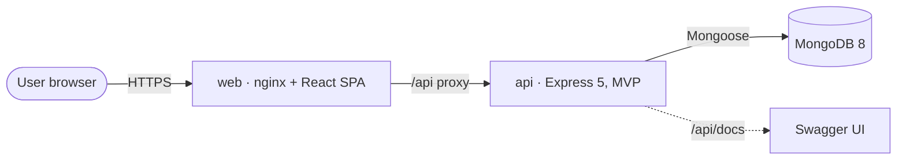
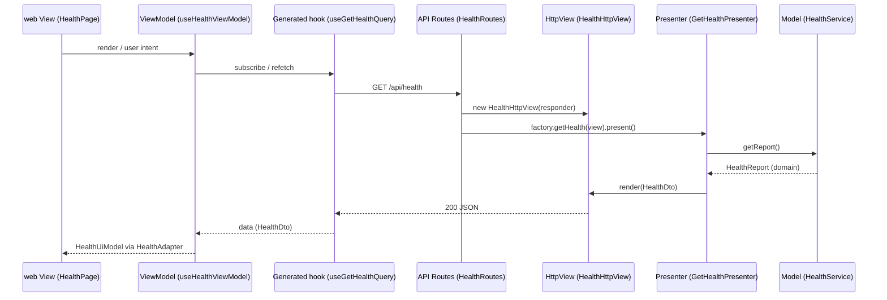

# Architecture overview

## System context



## Monorepo

```
apps/
  api/                 Express API — OOP, MVP Passive View        (ADR-0004, ADR-0005)
  web/                 Vite + React SPA — MVVM, RTK Query          (ADR-0011)
packages/
  contracts/           openapi.json + generated DTO types          (ADR-0009, ADR-0010)
  tsconfig/            shared tsconfig presets                     (ADR-0003)
docker/                Dockerfiles + nginx template                (ADR-0014)
docs/                  ADRs, architecture, guides
tools/biome/           GritQL architecture plugins                 (ADR-0013)
```

## End-to-end flow of one use case



## Contract pipeline

```
zod schemas (apps/api/src/modules/*/contracts)
   │  OpenApiRegistry (Adapter + Singleton)
   ▼
packages/contracts/openapi.json ──► /api/docs (Swagger UI)
   │                    │
   │ openapi-typescript │ @rtk-query/codegen-openapi
   ▼                    ▼
@mentora/contracts    apps/web/src/model/api/generated/mentoraApi.ts
(DTO types)           (endpoints + hooks)
```
