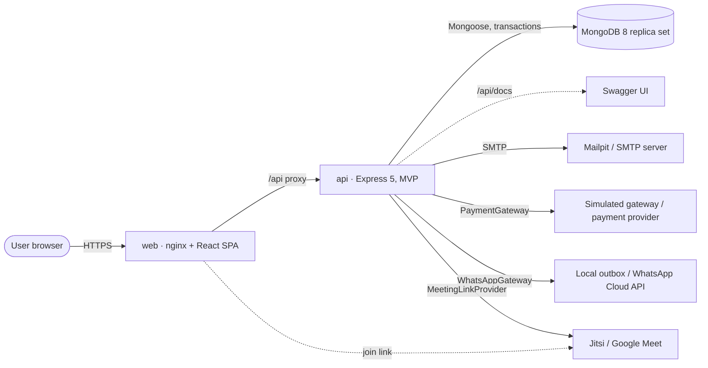
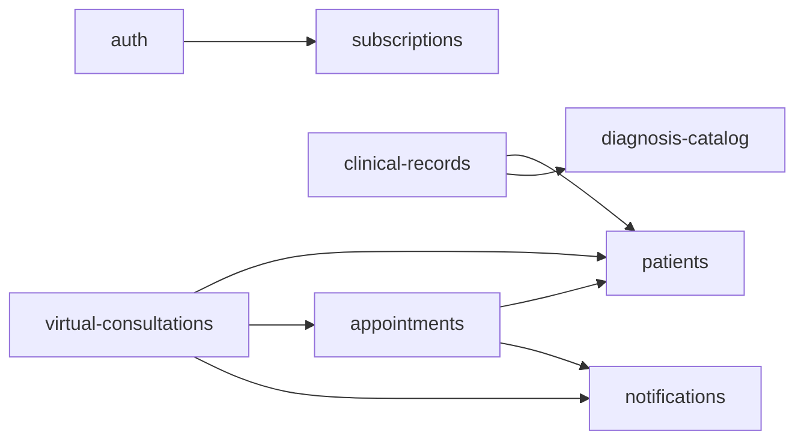
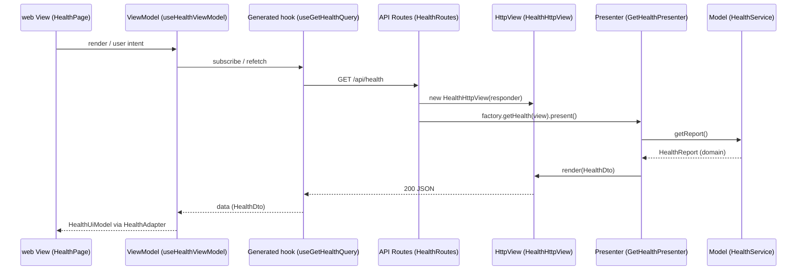

# Architecture overview

## System context



External services are reached through Model-owned ports and adapters (ADR-0007); the local
adapters are the default (ADR-0027, 0029, 0030, 0031).

## Backend modules



Arrows are calls through query or command services exported by `index.ts` (ADR-0022, ADR-0033),
wired in `apps/api/src/app/modules.ts`. Modules with periodic work declare scheduled jobs
(ADR-0026).

## Monorepo

```
apps/
  api/                 Express API — OOP, MVP Passive View        (ADR-0004, ADR-0005)
  web/                 Vite + React SPA — MVVM, RTK Query          (ADR-0011)
packages/
  contracts/           openapi.json + generated DTO types          (ADR-0009, ADR-0010)
  tsconfig/            shared tsconfig presets                     (ADR-0003)
docker/                Dockerfiles, nginx, Mongo users, backup     (ADR-0014, ADR-0038, ADR-0039)
docs/                  ADRs, architecture, guides, operations
tools/biome/           GritQL architecture plugins                 (ADR-0013)
tools/comments/        comment rule checker                        (ADR-0035)
tools/docs/            class diagram generator                     (ADR-0036)
tools/smoke/ tools/ops/ tools/db/   smoke test, restore drill, dev backups (ADR-0036, ADR-0039)
.github/               CI, CodeQL, release, Dependabot             (ADR-0036)
```

## End-to-end flow of one use case

More flows (login, payments, jobs, backups) are in [sequence-diagrams.md](sequence-diagrams.md);
every class is in the generated [class-diagram.md](class-diagram.md).



## Contract pipeline

```
zod schemas (apps/api/src/modules/*/contracts)
   │  OpenApiRegistry (Adapter + Singleton)
   ▼
packages/contracts/openapi.json ──► /api/docs (Swagger UI)
   │                    │
   │ openapi-typescript │ @rtk-query/codegen-openapi
   ▼                    ▼
@mentora/contracts    apps/web/src/model/api/generated/mentoraApi.ts
(DTO types)           (endpoints + hooks)
```
