# Sequence diagrams

The most important flows, drawn from the implemented code. Class names match the sources and the
[class diagram](class-diagram.md). Every diagram is Mermaid, so GitHub renders it.

| # | Flow | Use cases |
| --- | --- | --- |
| 1 | [Request lifecycle (MVP Passive View)](#1-request-lifecycle-mvp-passive-view) | all |
| 2 | [Log in and access check](#2-log-in-and-access-check) | CU-01, CU-18 |
| 3 | [Register with a free trial](#3-register-with-a-free-trial) | CU-03 |
| 4 | [Password recovery](#4-password-recovery) | CU-02 |
| 5 | [Register a consultation](#5-register-a-consultation) | CU-09, CU-06 |
| 6 | [Schedule an appointment and notify by WhatsApp](#6-schedule-an-appointment-and-notify-by-whatsapp) | CU-10, CU-14 |
| 7 | [Scheduled jobs: appointment reminders](#7-scheduled-jobs-appointment-reminders) | CU-14 |
| 8 | [Start a virtual consultation](#8-start-a-virtual-consultation) | CU-15 |
| 9 | [Choose a plan and pay](#9-choose-a-plan-and-pay) | CU-18 |
| 10 | [Automatic renewal](#10-automatic-renewal) | CU-18 |
| 11 | [Database backup and restore](#11-database-backup-and-restore) | operations |

## 1. Request lifecycle (MVP Passive View)

Every endpoint follows this path (ADR-0004, ADR-0025). The presenter never touches Express and
the view never decides anything.

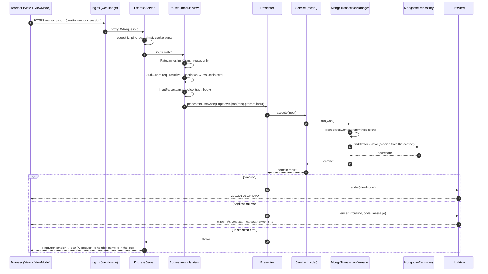

## 2. Log in and access check

Login always succeeds for valid credentials, even when the subscription has ended, so the
professional can still pay. Protected routes check the access date stored in the token; `/auth/me`
refreshes it after a payment (ADR-0018, ADR-0029, ADR-0034).

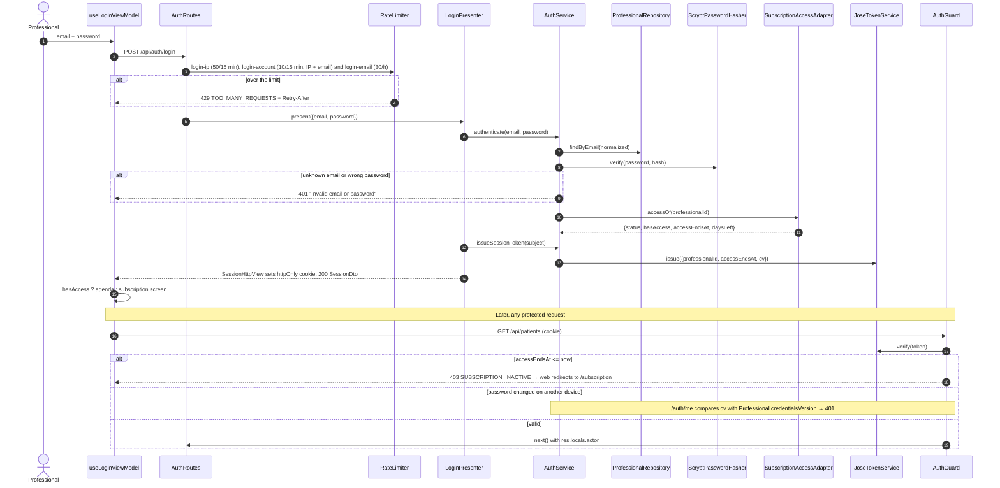

## 3. Register with a free trial

The professional and the trial subscription are written in one transaction. `auth` reaches
`subscriptions` through a consumer-owned port and an adapter (ADR-0022, ADR-0033).

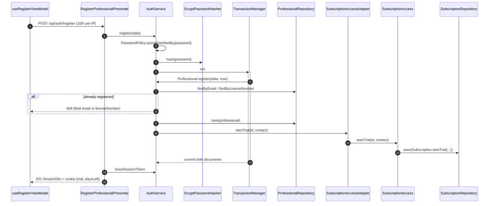

## 4. Password recovery

Same answer for known and unknown emails. Codes are 6 digits, hashed, valid 15 minutes, 5 attempts
and single use (ADR-0028). Resetting the password changes `credentialsVersion`, so every other
session gets 401 (ADR-0034).

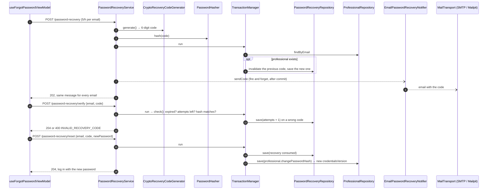

## 5. Register a consultation

The consultation is appended to the `ClinicalRecord` aggregate and the patient's last clinical
activity is updated in the same transaction, through the `patients` module (ADR-0020, ADR-0033).

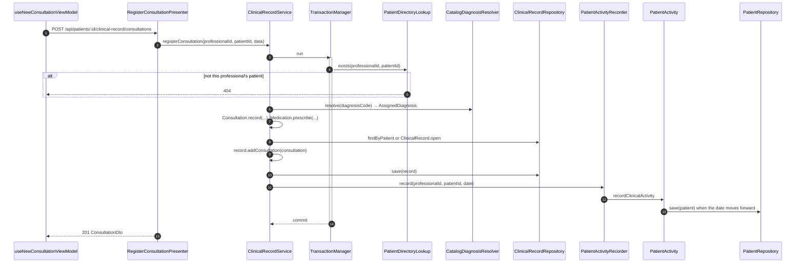

## 6. Schedule an appointment and notify by WhatsApp

The appointment is committed first. The WhatsApp message is sent after the commit, and a failed
delivery never undoes the appointment. Every attempt is logged (ADR-0030).

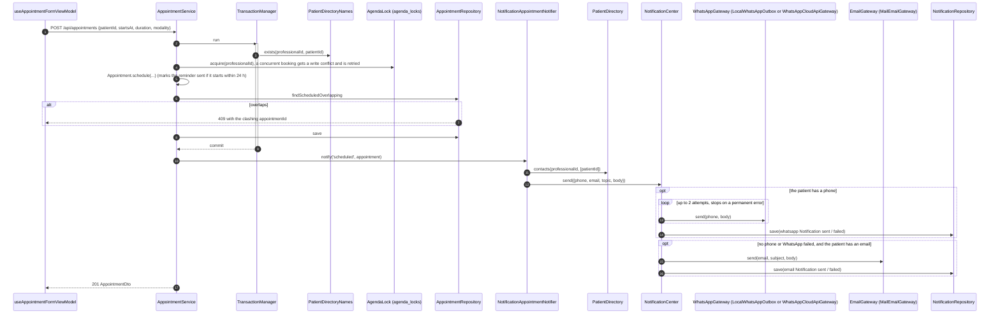

## 7. Scheduled jobs: appointment reminders

Three jobs run inside the API process: reminders (10 min), dormant patients (6 h) and renewals
(1 h). A Mongo lease makes sure only one API instance runs each job (ADR-0026, ADR-0037).

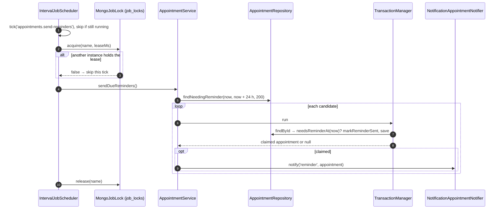

## 8. Start a virtual consultation

The link comes from the configured `MeetingLinkProvider` (Jitsi by default). A unique index on
`appointmentId` makes concurrent clicks return the same meeting (ADR-0031).

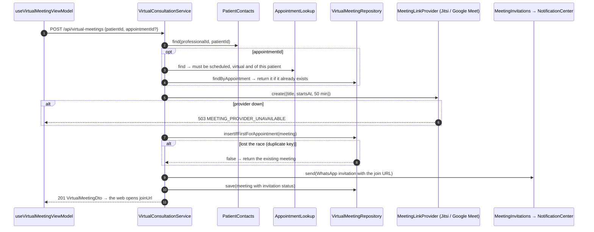

## 9. Choose a plan and pay

The charge runs between two short transactions, never inside one, so a slow provider does not hold
a database session. The idempotency key prevents double charges on retries (ADR-0029).

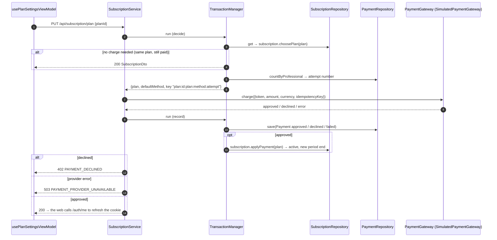

## 10. Automatic renewal

Run every hour by the `subscriptions.process-renewals` job. One failing subscription never stops
the batch; the report is logged.

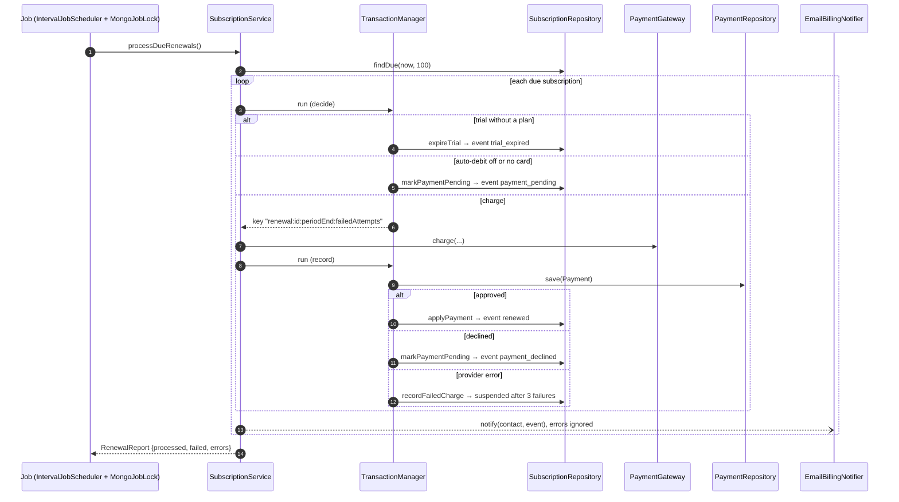

## 11. Database backup and restore

Production backups run in the `backup` container with a read-only `backup` user. Restores are done
by an operator with the `restore` role (ADR-0039, [backup-and-restore.md](../operations/backup-and-restore.md)).

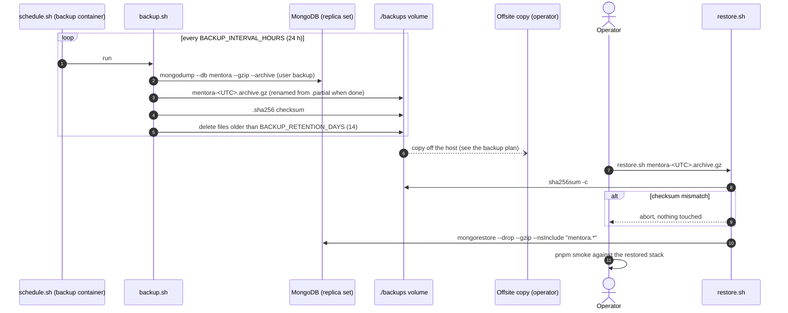
