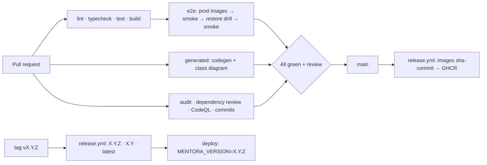

# CI/CD

Decision: [ADR-0036](../adr/0036-ci-cd-quality-gates.md). Workflows live in `.github/workflows`.



## Workflows

| Workflow | Trigger | What it does |
| --- | --- | --- |
| `ci.yml` | PR, push to `main` | Quality gates below |
| `codeql.yml` | PR, push to `main`, weekly | CodeQL `security-extended` for TypeScript and Actions |
| `release.yml` | push to `main`, tag `v*.*.*`, manual | Multi-arch images to GHCR with SBOM and provenance |
| `dependabot.yml` | weekly | npm, Actions and Docker base image updates |

## Required checks on `main`

Configure **Settings → Branches → Branch protection** (or a ruleset) for `main`:

- Require a pull request with 1 approval; dismiss stale approvals.
- Require these status checks: `Lint (Biome, architecture, comments)`, `Typecheck`,
  `Unit and integration tests`, `Build`, `Generated code and docs are up to date`,
  `Dependency audit (production, high and critical)`, `Conventional commits`,
  `Dependency review`, `Production images, smoke test and restore drill`,
  `Analyze (javascript-typescript)`, `Analyze (actions)`.
- Require branches to be up to date; require linear history; block force pushes.

## Reproduce a failing check locally

| Check | Command |
| --- | --- |
| Lint | `pnpm lint` (fix with `pnpm lint:fix`) |
| Typecheck / tests / build | `pnpm typecheck` · `pnpm test` · `pnpm build` |
| Generated | `pnpm codegen` and `pnpm docs:classes`, then commit the changes |
| Audit | `pnpm audit --prod --audit-level high`; upgrade or add an `overrides` entry in `pnpm-workspace.yaml` |
| Commits | `node tools/git/commit-msg.mjs <file>`; reword with Conventional Commits |
| E2E | see below |

E2E locally (Docker required):

```bash
docker build -f docker/api.Dockerfile --target runtime -t ghcr.io/org-mentora/mentora-api:ci .
docker build -f docker/web.Dockerfile --target runtime -t ghcr.io/org-mentora/mentora-web:ci .
cat > .env.ci <<EOF
MENTORA_VERSION=ci
APP_URL=http://localhost:8080
JWT_SECRET=$(openssl rand -hex 32)
MONGO_ROOT_PASSWORD=$(openssl rand -hex 16)
MONGO_APP_PASSWORD=$(openssl rand -hex 16)
MONGO_BACKUP_PASSWORD=$(openssl rand -hex 16)
SMTP_URL=smtp://localhost:1025
MAIL_FROM=Mentora CI <ci@mentora.test>
EOF
docker compose -p mentora-ci -f docker-compose.prod.yml --env-file .env.ci up -d --wait
pnpm smoke
bash tools/ops/restore-drill.sh -p mentora-ci -f docker-compose.prod.yml --env-file .env.ci
docker compose -p mentora-ci -f docker-compose.prod.yml --env-file .env.ci down -v
rm .env.ci
```

## Releasing

1. Merge to `main`; `release.yml` publishes `sha-<commit>` images.
2. Tag the commit: `git tag -a v1.5.0 -m "v1.5.0" && git push origin v1.5.0`.
3. `release.yml` publishes `1.5.0`, `1.5` and `latest`.
4. Deploy by setting `MENTORA_VERSION=1.5.0` ([deployment.md](deployment.md#upgrade)).

Versions follow SemVer: a breaking API or data change bumps the major version.

## Supply chain rules

- Actions are pinned by full commit SHA (`uses: owner/action@<sha> # vX.Y.Z`); Dependabot moves
  them.
- Default token permission is `contents: read`; only `release.yml` can write packages and only
  `codeql.yml` can write security events.
- pnpm installs with a frozen lockfile, `minimumReleaseAge` (new versions wait before they can be
  installed) and an allow-list of dependency build scripts (ADR-0002).
- `aquasecurity/trivy-action` is not used after its March 2026 compromise (ADR-0036).
