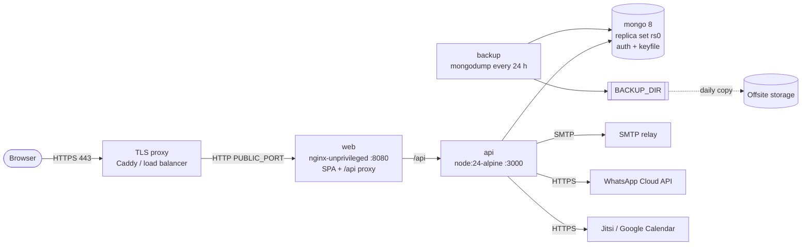

# Deployment

Mentora ships as two container images and runs on one Linux host with Docker Compose
([ADR-0038](../adr/0038-production-images-and-deployment.md)).



## Images

| Image | Base | User | Port | Health check |
| --- | --- | --- | --- | --- |
| `ghcr.io/org-mentora/mentora-api` | `node:24-alpine` | `node` | 3000 | `GET /api/health/live` |
| `ghcr.io/org-mentora/mentora-web` | `nginxinc/nginx-unprivileged:1.29-alpine` | `nginx` (101) | 8080 | `GET /healthz` |

Tags (from `release.yml`, [ci-cd.md](ci-cd.md)): `sha-<commit>` for every push to `main`;
`X.Y.Z`, `X.Y` and `latest` for a `vX.Y.Z` tag. Both images are multi-arch (amd64, arm64) and
carry an SBOM and provenance attestation. Check one with:

```bash
docker buildx imagetools inspect ghcr.io/org-mentora/mentora-api:1.0.0 --format '{{ json .SBOM }}'
```

Build locally (same as CI):

```bash
docker build -f docker/api.Dockerfile --target runtime -t ghcr.io/org-mentora/mentora-api:dev \
  --build-arg VERSION=dev --build-arg REVISION=$(git rev-parse HEAD) .
docker build -f docker/web.Dockerfile --target runtime -t ghcr.io/org-mentora/mentora-web:dev .
```

## Host requirements

- Linux VM with 2 vCPU, 4 GB RAM and 40 GB disk (MongoDB is limited to 2 GB, the API to 512 MB,
  nginx to 128 MB).
- Docker Engine 27+ with the Compose plugin.
- A DNS name pointing at the host and ports 80/443 open for the TLS proxy. Nothing else is
  exposed: MongoDB has no published port.
- Outbound access to the SMTP relay, GHCR and, if enabled, the WhatsApp and Google APIs.

## First deployment

```bash
git clone https://github.com/org-mentora/mentora.git && cd mentora   # compose file + scripts
cp .env.production.example .env.production
# Fill every CHANGE value; pin MENTORA_VERSION to a released tag.
chmod 600 .env.production

docker compose -f docker-compose.prod.yml --env-file .env.production pull
docker compose -f docker-compose.prod.yml --env-file .env.production up -d --wait
BASE_URL=http://localhost:8080 node tools/smoke/smoke.mjs   # creates a smoke-test professional
```

On the first start the `mongo-keyfile` service writes the replica set key into a volume, MongoDB
creates the `mentora` and `backup` users from `docker/mongo/init-users.js`, and its health check
initiates the replica set. The API starts only when MongoDB is a writable primary, and the web only
when the API is healthy.

The smoke test registers a throwaway professional. On a real installation delete it afterwards,
or run the smoke test against a staging copy instead.

## TLS in front of the web container

The web container speaks plain HTTP on `PUBLIC_PORT`. Terminate TLS in front of it. With Caddy on
the same host:

```caddyfile
mentora.example.com {
  encode zstd gzip
  reverse_proxy 127.0.0.1:8080
  header Strict-Transport-Security "max-age=31536000; includeSubDomains"
}
```

Set `APP_URL=https://mentora.example.com`. Requests go through two proxies: Caddy and the web
nginx. The API trusts both hops (`TRUST_PROXY=2`, the default of `docker-compose.prod.yml`), so
`req.ip` is the client address that Caddy wrote in `X-Forwarded-For`. Rate limits are counted
per client IP, so this value must match the number of proxies.

- The web port binds to `127.0.0.1` (`PUBLIC_BIND`), so only the local Caddy can reach it and
  nobody can forge `X-Forwarded-For` by calling nginx directly.
- Without a TLS proxy (for example a private network test), set `PUBLIC_BIND=0.0.0.0` and
  `TRUST_PROXY=1`.

## Upgrade

```bash
# 1. Back up first (takes a minute).
docker compose -f docker-compose.prod.yml --env-file .env.production exec backup sh /scripts/backup.sh
# 2. Move to the new version.
sed -i 's/^MENTORA_VERSION=.*/MENTORA_VERSION=1.5.0/' .env.production
docker compose -f docker-compose.prod.yml --env-file .env.production pull api web
docker compose -f docker-compose.prod.yml --env-file .env.production up -d --wait api web
# 3. Verify.
curl -fsS http://localhost:8080/api/health/ready
```

The API drains requests on `SIGTERM` (`SHUTDOWN_TIMEOUT_MS`, inside a 20 s
`stop_grace_period`). One-off data migrations run once at boot and are recorded in the
`migrations` collection ([ADR-0037](../adr/0037-operational-readiness.md)).

## Rollback

Set `MENTORA_VERSION` back to the previous tag and run `up -d --wait api web`. If the new
version changed data in a way the old one cannot read, restore the backup taken in step 1
([backup-and-restore.md](backup-and-restore.md)).

## Moving to an orchestrator

The images are ready for Kubernetes or a container platform: non-root, read-only root file
system, `SIGTERM` handling, and separate probes (`livenessProbe` → `/api/health/live`,
`readinessProbe` → `/api/health/ready`). Use a managed MongoDB replica set (Atlas) and run the API
with `SCHEDULER_ENABLED=true` on every replica: `MongoJobLock` makes each job run on one instance.
